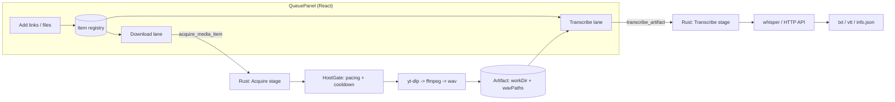

# PLAN-QUEUE-V2 — разделение очереди на Download / Transcribe + троттлинг сети

Дата: 2026-07-29. Автор: архитектор (Опус). Исполнитель: любой агент по задачам ниже.
Статус: design approved for implementation, задачи не начаты.

Документ **самодостаточный**: исполняющему агенту не нужно читать другие планы.
Ответы пользователю — русский. Код, комментарии, UI-строки — английский.

---

## 1. Диагноз: почему падают TikTok-ссылки

Источник: `C:\Users\vetal\AppData\Roaming\com.v2t.app\logs\v2t-2026-07-25-182111.log` (8 МБ, прогон ~590 TikTok URL).

### 1.1 Что в логе

| Ошибка | Вхождений | Природа |
|---|---|---|
| `HTTP Error 403: Forbidden` | 180 | Шилд/сессия отвергает запрос — **временная**, проходит после паузы |
| `HTTP Error 503: Service Unavailable` | 101 | Троттлинг на стороне TikTok — **временная** |
| `HTTP Error 429: Too Many Requests` | 5 | **Явный rate limit** — прямое доказательство |
| `Unable to extract universal data for rehydration` | 11 | Устаревший экстрактор yt-dlp |
| `Unsupported URL` | 6 | Фото-посты `/photo/<id>` — **постоянная**, не лечится |

Дополнительно в логе: `WARNING: Your yt-dlp version (2026.03.17) is older than 90 days!`

### 1.2 Корневая причина — амплификация запросов

Текущие настройки пользователя: `keepDownloadedVideo: true`, `keepDownloadedAudio: true`,
`useSubtitlesWhenAvailable: false`, `cookiesFromBrowser: firefox`.

При таких настройках **один** TikTok URL порождает **три** последовательных запуска yt-dlp:

| # | Где в коде | Что делает |
|---|---|---|
| 1 | `src-tauri/src/job.rs:337-385` → `src-tauri/src/yt_dlp_metadata.rs:65-117` | Pre-resolve метаданных (`--flat-playlist --dump-single-json`) |
| 2 | `src-tauri/src/pipeline.rs:865-904` | Основное скачивание (TikTok → `-f` H.264, полный mp4 в temp) |
| 3 | `src-tauri/src/pipeline.rs:1099-1136` → `src-tauri/src/pipeline.rs:719-814` | Второй проход `download_best_video_mp4` в output-папку |

**590 URL × 3 = ~1770 обращений к TikTok, вплотную, без единой паузы.**
Между запусками нет `sleep`, нет `--sleep-requests`, нет `--retries`, нет backoff
(подтверждено: `build_yt_dlp_download_args`, `src-tauri/src/pipeline.rs:99-137` — этих флагов нет).

Отсюда 429 → затем шилд отдаёт 503 в одном окне и 403 в другом. Ощущение пользователя
(«нужна пауза») подтверждается логом.

### 1.3 Второй проход скачивает то же самое дважды

Для TikTok первый проход (`src-tauri/src/pipeline.rs:865-875`) идёт **без** `-x`,
с форматом `YT_DLP_TIKTOK_H264_FORMAT` — то есть уже скачивает **полный mp4 со звуком**
в temp work dir. После этого `keep_downloaded_video` запускает
`download_best_video_mp4` (`src-tauri/src/pipeline.rs:1099-1136`), который качает
**тот же ролик снова** в output-папку.

Итог: удвоение и запросов, и трафика ради файла, который уже лежит на диске.

### 1.4 Retry не помогает при HTTP-ошибках

В `prepare_media_audio` есть 4 варианта retry (`src-tauri/src/pipeline.rs:907-1096`),
но все они лечат **кодеки и cookies**, а не HTTP-статусы:

1. cookie DB failure → повтор без cookies;
2. `-x` postprocess failed → `-f ba/b`;
3. нет audio-дорожки → `-f bv*+ba/b --merge-output-format mp4`;
4. TikTok без звука → H.264-формат.

403 / 503 / 429 не попадают ни в одно условие → job падает **сразу**, без паузы и без повтора.
Плюс все retry выполняются мгновенно, что само добавляет запросов в момент, когда сервер и так троттлит.

### 1.5 Выводы по диагнозу

1. Троттлинг реален (429 в логе). Пауза нужна — но сама по себе она лишь маскирует проблему.
2. Главный рычаг — **убрать амплификацию**: 3 запроса на URL → 1. Это в 3 раза снижает темп без потери функциональности.
3. Нужна классификация ошибок и retry с backoff: 403/503/429 — повторяемые, `Unsupported URL` — нет.
4. yt-dlp устарел (>90 дней) → 11 ошибок `rehydration` лечатся обновлением бинаря.
5. Фото-посты не должны считаться «битыми ссылками» — это отдельный статус `unsupported`.

---

## 2. Оценка идеи «две очереди»

Пользователь просит: очередь скачивания со своими интервалами + отдельная очередь распознавания,
независимые друг от друга.

**Оценка: идея верная, и её стоит делать — но по конкретной причине.**

Выгода не в скорости сети (скачивание всё равно надо замедлять), а в том, что
**пауза скачивания перестаёт простаивать GPU**. Сейчас всё линейно
(`src-tauri/src/job.rs:279` — одна функция от скачивания до записи `.txt`;
`src/components/QueuePanel.tsx:467-490` — один `for` + `await`), поэтому если поставить
паузу 5 секунд между скачиваниями, эти 5 секунд **вся программа стоит**, включая whisper.
При 590 роликах это часы простоя.

Разделив стадии, мы получаем: пока Whisper обрабатывает ролик N, загрузчик уже
отсчитывает свою паузу и тянет ролик N+1. Пауза становится бесплатной.

**Что важно спроектировать правильно, а не «просто разделить»:**

- **Backpressure.** Если скачивание быстрее транскрипции, wav-файлы накопятся в temp и забьют диск.
  Нужен лимит незавершённых артефактов.
- **Артефакт между стадиями.** Сейчас temp work dir живёт внутри одного job и удаляется в конце
  (`delete_audio_after`). При разделении артефакт должен переживать границу стадий.
- **Отмена.** `JobCancelRegistry` (`src-tauri/src/cancel_registry.rs:7-47`) сейчас один токен на job.
  Понадобится токен на стадию.
- **Прецедент в коде уже есть.** BrowserWhisper-режим уже работает в две фазы:
  Rust готовит (`src-tauri/src/job.rs:516-581` → `BrowserPrepared`), JS транскрибирует,
  Rust дописывает (`browser_queue_job_finish`, `src-tauri/src/lib.rs:150-179`).
  Значит двухстадийная схема ложится на существующую архитектуру, а не ломает её.

---

## 3. Целевая архитектура

### 3.1 Схема



### 3.2 Две дорожки, один реестр

Внутри — **один** список элементов, у каждого две независимые стадии.
В UI — **две панели**, элемент виден в «Download», затем переезжает в «Transcription».
Это то, что просил пользователь, и при этом не ломает retry и связь элемента с результатом.

Новая модель (`src/types/queue.ts`):

```ts
export type StageStatus =
  | "pending"
  | "waiting"      // ждёт окна pacing / backoff
  | "running"
  | "done"
  | "error"
  | "unsupported"  // фото-пост и т.п. — повтор бессмысленен
  | "cancelled";

export type StageState = {
  status: StageStatus;
  detail?: string;
  attempts: number;
  /** epoch ms; для status="waiting" — когда можно пробовать снова */
  nextAttemptAt?: number;
  /** Классификация последней ошибки, из Rust. */
  failureKind?: DownloadFailureKind;
};

export type AcquiredArtifact = {
  workDir: string;
  wavPaths: string[];
  sourceMediaFiles: string[];
  sourceMediaFilesAreAudio: boolean;
  /** Байты на диске — для backpressure. */
  bytesOnDisk: number;
};

export type QueueItem = {
  id: string;
  kind: QueueJobKind;
  source: string;
  displayLabel: string;
  language: string | null;
  acquire: StageState;
  transcribe: StageState;
  artifact?: AcquiredArtifact;
  transcriptPath?: string | null;
  playlistTitle?: string;
  subtasks?: SubtaskState[];
};
```

Существующий `QueueJob` (`src/types/queue.ts:34-50`) заменяется на `QueueItem`.
Производный статус для обратной совместимости отображения:
`itemStatus(item)` = `error` если любая стадия `error`; `done` если `transcribe.done`; и т.д.

### 3.3 Два независимых runner-а

| Runner | Конкурентность | Сеть | Особенности |
|---|---|---|---|
| **Acquire** | `acquireConcurrency`, default **1** | да | pacing между старта́ми, backoff при ошибках, глобальный cooldown при 429 |
| **Transcribe** | `transcribeConcurrency`, default **1** | нет (кроме HTTP-режима) | без pacing; берёт элементы с `acquire.status === "done"` |

Оба крутятся одновременно, независимо. Стоп-кнопки раздельные + общий «Stop all».

**Backpressure:** Acquire не начинает новый элемент, если
(число артефактов, ждущих транскрипции) ≥ `maxPendingArtifacts` (default 10)
ИЛИ (их суммарный размер) ≥ `maxPendingArtifactsMb` (default 4096).
В этом состоянии дорожка Download показывает `waiting: transcription is behind`.

### 3.4 Новые Tauri-команды

Существующая `process_queue_item` (`src-tauri/src/lib.rs:113-147`) **остаётся** —
её использует REST API (`src-tauri/src/api_server.rs`) и она нужна для обратной совместимости.
Внутри она переписывается как `acquire` + `transcribe` подряд, чтобы логика не дублировалась.

Новые команды:

```rust
/// Stage A: URL/file -> normalized wav artifact. Никакой транскрипции.
#[tauri::command]
async fn acquire_media_item(
    app: tauri::AppHandle,
    registry: tauri::State<'_, JobCancelRegistry>,
    gate: tauri::State<'_, HostGate>,
    job_id: String,
    job_index: u32,
    source: String,
    source_kind: String,
    display_label: String,
    settings: AppSettings,
) -> Result<AcquireOutcome, String>;

/// Stage B: артефакт -> txt/vtt/info.json.
#[tauri::command]
async fn transcribe_artifact(
    app: tauri::AppHandle,
    registry: tauri::State<'_, JobCancelRegistry>,
    job_id: String,
    artifact: AcquiredArtifact,
    display_label: String,
    settings: AppSettings,
) -> Result<ProcessQueueItemResult, String>;

/// Удалить temp-артефакт (отмена/очистка элемента без транскрипции).
#[tauri::command]
fn discard_artifact(artifact: AcquiredArtifact) -> Result<(), String>;
```

`AcquireOutcome` повторяет паттерн существующего `ProcessQueueItemOutcome`
(`src-tauri/src/job.rs`, используется в `src-tauri/src/lib.rs:125`):

```rust
pub enum AcquireOutcome {
    /// Обычный путь: есть wav, нужна стадия B.
    Ready(AcquiredArtifact),
    /// Транскрипт уже получен без ASR: subtitle fast-path или vision/OCR.
    Completed { transcript_path: String, summary: String },
    /// BrowserWhisper: транскрипция в WASM на стороне JS.
    BrowserPrepared { /* существующая форма */ },
}
```

### 3.5 Раскладка существующего `run_process_queue_item` по стадиям

`src-tauri/src/job.rs:279-893` разрезается **без изменения логики шагов**:

| Стадия | Шаги (текущие строки `job.rs`) |
|---|---|
| **Acquire** | `292` require_output_dir · `294-307` vision fast-path → `Completed` · `309-310` resolve ffmpeg · `314-328` video template · `337-385` pre-resolve · `387-421` subs fast-path → `Completed` · `423-429` audio format · `431-447` `prepare_media_audio` · `449-451` проверка wav · `455-473` save audio · `475-478` work dir · `482-514` media info (remote) · `516-581` → `BrowserPrepared` · иначе → `Ready(artifact)` |
| **Transcribe** | `585-869` цикл транскрипции + diarize + запись `.txt`/`.vtt` + info sidecar + cleanup checkpoints · `871-893` финал, удаление temp по `delete_audio_after` |

Remote media-info из стадии A нужен стадии B (пишется в `.info.json`) → добавить его
в `AcquiredArtifact` как `remote_media_info: Option<RemoteMediaFacts>`
(тип уже есть в `src-tauri/src/media_info.rs`).

### 3.6 Новый модуль: `src-tauri/src/net_pacing.rs`

Единственная точка, где вводится задержка. Всё, что запускает yt-dlp, проходит через неё.

```rust
/// Per-host request pacing + escalating cooldown after rate-limit responses.
pub struct HostGate { /* Mutex<HashMap<String, HostState>> */ }

pub struct PacingConfig {
    pub min_interval: Duration,   // downloadMinIntervalMs
    pub jitter: Duration,         // downloadJitterMs
    pub cooldown_on_429: Duration,// downloadCooldownMs
}

impl HostGate {
    /// Ждёт своё окно для host. Уважает cancel. Вызывать ПЕРЕД spawn yt-dlp.
    pub async fn acquire(&self, host: &str, cfg: &PacingConfig, cancel: &CancellationToken)
        -> Result<(), String>;

    /// Сообщить о результате: успех сбрасывает cooldown, rate-limit — наращивает.
    pub fn report(&self, host: &str, outcome: PacingOutcome);
}

pub enum PacingOutcome { Ok, RateLimited, ServerBusy }
```

Правила:

- перед каждым spawn: `sleep(min_interval + rand(0..jitter))` от момента прошлого spawn для этого хоста;
- `RateLimited` (429) → cooldown = `cooldown_on_429`, далее удвоение при повторе, cap `downloadBackoffMaxMs`;
- `ServerBusy` (503/403 подряд ≥3 раза) → cooldown = половина от 429-го;
- успех → сброс множителя.

Хост извлекается из URL (без внешних крейтов: взять подстроку между `://` и следующим `/`).
Регистрируется как Tauri state в `src-tauri/src/lib.rs:344-346` рядом с `JobCancelRegistry`.

### 3.7 Новый модуль: `src-tauri/src/yt_dlp_error.rs`

```rust
#[derive(Debug, Clone, Copy, PartialEq, Eq, Serialize)]
#[serde(rename_all = "camelCase")]
pub enum DownloadFailureKind {
    RateLimited,        // 429
    ServiceUnavailable, // 502 / 503 / 504
    Forbidden,          // 403
    Unsupported,        // "Unsupported URL" -> фото-пост
    Unavailable,        // 404, private, removed, "Video not available"
    ExtractorStale,     // "universal data for rehydration" -> обновить yt-dlp
    CookieStore,        // существующий yt_dlp_cookie_db_failure
    Stalled,            // heartbeat kill
    Other,
}

pub fn classify(stderr: &[u8]) -> DownloadFailureKind;

impl DownloadFailureKind {
    /// Стоит ли повторять после паузы.
    pub fn is_retryable(self) -> bool;
    /// Пауза перед попыткой №attempt (1-based), экспонента + jitter.
    pub fn backoff(self, attempt: u32, cfg: &PacingConfig) -> Duration;
}
```

`is_retryable`: `RateLimited`, `ServiceUnavailable`, `Forbidden`, `Stalled` → `true`.
`Unsupported`, `Unavailable`, `ExtractorStale` → `false`.
`CookieStore` → `false` (уже лечится существующим retry без cookies).

Классификатор переиспользует существующий `yt_dlp_cookie_db_failure`
(`src-tauri/src/pipeline.rs:67-72`) и вызывается из `format_yt_dlp_fail`
(`src-tauri/src/pipeline.rs:74-84`), чтобы текст ошибки нёс тип.

### 3.8 Новые настройки

В `src-tauri/src/settings.rs` (`AppSettings`, `serde camelCase`) и `src/types/settings.ts`:

| Поле | Тип | Default | Смысл |
|---|---|---|---|
| `downloadMinIntervalMs` | u32 | `1500` | Минимум между старта́ми yt-dlp на один хост |
| `downloadJitterMs` | u32 | `750` | Случайная добавка, чтобы не бить ровным ритмом |
| `downloadMaxAttempts` | u8 | `4` | Попыток на элемент при повторяемой ошибке |
| `downloadBackoffBaseMs` | u32 | `5000` | База экспоненты backoff |
| `downloadBackoffMaxMs` | u32 | `120000` | Потолок backoff/cooldown |
| `downloadCooldownMs` | u32 | `60000` | Пауза для хоста после 429 |
| `acquireConcurrency` | u8 | `1` | Параллельных скачиваний |
| `transcribeConcurrency` | u8 | `1` | Параллельных транскрипций |
| `maxPendingArtifacts` | u8 | `10` | Backpressure по числу |
| `maxPendingArtifactsMb` | u32 | `4096` | Backpressure по размеру |

Все с `#[serde(default = "...")]`, чтобы старые `settings.json` читались без миграции.

---

## 4. Задачи

Порядок обязателен: 1-3 дают эффект сразу и почти без риска, 4-6 — сам рефакторинг.
После каждой задачи: `cd src-tauri; cargo check` и/или `npm run build`, затем коммит.
Одна задача = один коммит. Не смешивать задачи.

---

### TASK-Q2-1 — Убрать амплификацию запросов (3 → 1 на URL)

**Приоритет:** критический. **Риск:** низкий. **Эффект:** темп запросов падает втрое.

**Файлы:** `src-tauri/src/job.rs`, `src-tauri/src/pipeline.rs`

**Что сделать:**

1. **Не делать pre-resolve для одиночного видео.**
   В `src-tauri/src/job.rs:337-385` перед вызовом `yt_dlp_metadata::resolve_playlist_metadata`
   добавить проверку: если URL заведомо одиночный — пропустить.
   Хелпер в `src-tauri/src/yt_dlp_metadata.rs`:
   ```rust
   /// True when the URL cannot be a playlist, so pre-resolve would waste a request.
   pub fn is_single_item_url(url: &str) -> bool
   ```
   Правила: содержит `tiktok.com/` и (`/video/` или `/photo/`) → single;
   содержит `youtu.be/` без `list=` → single;
   `youtube.com/watch` без `list=` → single;
   иначе → не single (оставить pre-resolve).
   Unit-тесты на каждое правило.

2. **Переиспользовать уже скачанный mp4 вместо второго прохода.**
   В `src-tauri/src/pipeline.rs:1099-1136`: если `keep_downloaded_video` и первый проход уже
   дал видеофайл (не `-x`, т.е. `source_media_files_are_audio == false`, случай TikTok),
   то **скопировать** файл из temp в `video_output_template` вместо вызова
   `download_best_video_mp4`. Вызов второго прохода остаётся только когда первый проход
   дал аудио (`-x`), т.е. видеофайла на диске нет.
   Шаблон yt-dlp (`%(title)s` и т.п.) в этом случае не раскрывается — использовать то же имя,
   что даёт `output_template` для транскрипта, с расширением исходного файла.
   Логировать `emit_pipeline_text(..., "yt-dlp-video", "Reused downloaded video (no second request).")`.

3. **Не делать отдельный `--dump-json`, если pre-resolve уже дал данные.**
   В `src-tauri/src/job.rs:482-514`: если `keep_media_info` и pre-resolve уже вернул сведения
   по этому URL — использовать их, `media_info::fetch_remote_facts` не вызывать.

**Не делать:** троттлинг (TASK-Q2-2), рефакторинг стадий (TASK-Q2-4).

**Проверка:**
- `cd src-tauri; cargo test yt_dlp_metadata` — тесты `is_single_item_url` зелёные;
- `cargo check`;
- ручной прогон одного TikTok URL с `keepDownloadedVideo: true`: в логе
  **один** блок `[yt-dlp]` и строка про reused video, блока `[yt-dlp-video]` со скачиванием нет;
- mp4 в output-папке присутствует и играется.

---

### TASK-Q2-2 — Классификация ошибок + pacing + retry с backoff

**Приоритет:** критический. **Риск:** средний. **Зависит от:** TASK-Q2-1.

**Файлы (новые):** `src-tauri/src/yt_dlp_error.rs`, `src-tauri/src/net_pacing.rs`
**Файлы (правки):** `src-tauri/src/pipeline.rs`, `src-tauri/src/lib.rs`,
`src-tauri/src/settings.rs`, `src-tauri/src/yt_dlp_metadata.rs`, `src-tauri/src/subs.rs`,
`src-tauri/src/media_info.rs`, `src/types/settings.ts`

**Что сделать:**

1. Создать `yt_dlp_error.rs` по спецификации §3.7 с unit-тестами на каждый вариант
   (строки-образцы брать из §1.1: `HTTP Error 403: Forbidden`, `HTTP Error 503`,
   `HTTP Error 429: Too Many Requests`, `Unsupported URL`,
   `Unable to extract universal data for rehydration`).
2. Создать `net_pacing.rs` по спецификации §3.6 с unit-тестами на
   min-interval, эскалацию cooldown и сброс после успеха (время инжектить, не спать в тестах).
3. Добавить настройки из §3.8 в `settings.rs` + `src/types/settings.ts` + `defaultAppSettings`.
4. Добавить `HostGate` в Tauri state (`src-tauri/src/lib.rs:344-346`).
5. Ввести обёртку в `pipeline.rs`:
   ```rust
   /// Pace by host, run yt-dlp, then report the outcome back to the gate.
   pub(crate) async fn run_yt_dlp_paced(
       gate: &HostGate, cfg: &PacingConfig, source_url: &str,
       program: &Path, args: &[String], heartbeat: Duration,
       cancel: &CancellationToken, maybe_log: Option<(&SinkHandle, &str)>,
       phase_label: &str,
   ) -> Result<std::process::Output, String>
   ```
   и перевести на неё **все** места запуска yt-dlp: основное скачивание
   (`pipeline.rs:889`), все retry-ветки (`907-1096`), `download_best_video_mp4`
   (`pipeline.rs:719-814`), pre-resolve (`yt_dlp_metadata.rs:99`),
   subtitle probe/fetch (`subs.rs`), media-info dump (`media_info.rs`).
   Для локальных файлов gate не применяется.
6. Retry по HTTP-ошибкам в `prepare_media_audio`: если `classify(stderr).is_retryable()`
   и попытка < `downloadMaxAttempts` — подождать `backoff(attempt)` (с уважением к `cancel`)
   и повторить **тот же** запрос. Существующие 4 retry-ветки по кодекам/cookies не трогать —
   новый retry оборачивает их снаружи.
   Перед каждой паузой: `emit_pipeline_text(..., "yt-dlp", "Rate limited (429). Waiting 60s before retry 2/4…")`.
7. Текст финальной ошибки должен содержать тип: `format_yt_dlp_fail`
   (`pipeline.rs:74-84`) дополняется строкой вида `[rateLimited]`, чтобы UI мог отличать.
   Для `ExtractorStale` добавить подсказку: `yt-dlp is outdated — update it in Preferences → Tools.`

**Не делать:** разделение очередей, изменения UI кроме полей настроек.

**Проверка:**
- `cd src-tauri; cargo test yt_dlp_error net_pacing` — зелёные;
- `cargo check`; `npm run build`;
- ручной прогон 20 TikTok URL: в логе видны строки ожидания, между запусками yt-dlp
  ≥1.5 с, при 429 — пауза и повтор, доля успешных выше, чем без задачи.

---

### TASK-Q2-3 — Фото-посты и обновление yt-dlp

**Приоритет:** высокий. **Риск:** низкий. **Зависит от:** TASK-Q2-2.

**Файлы:** `src-tauri/src/failed_links.rs`, `src-tauri/src/lib.rs`,
`src/components/QueuePanel.tsx`, `src/lib/queueUtils.ts`, `src/locales/{en,ru}/queue.json`,
`src-tauri/src/tool_download.rs`, `src/components/SettingsPanel.tsx`

**Что сделать:**

1. Определять неподдерживаемые ссылки **до** запуска yt-dlp.
   Хелпер в `src/lib/queueUtils.ts`:
   ```ts
   /** TikTok photo posts and other non-media links yt-dlp cannot fetch. */
   export function isUnsupportedMediaUrl(url: string): boolean
   ```
   Правило: `tiktok.com` + `/photo/` → true. Плюс профильные ссылки без `/video/`
   (`tiktok.com/@user` без дальнейшего пути) → true.
   При добавлении в очередь такие элементы получают стадию `acquire.status = "unsupported"`
   и **не отправляются** в Rust. Unit-тесты.
2. `save_failed_links` (`src-tauri/src/failed_links.rs`) должен исключать `unsupported`
   из результата — в файл битых ссылок попадают только реально повторяемые.
   Добавить параметр `unsupported_urls: Vec<String>` и писать их в отдельный файл
   `<basename>.unsupported.txt` рядом. Unit-тест.
3. Показать версию yt-dlp и предупреждение о старости.
   В `src-tauri/src/tool_download.rs` добавить команду:
   ```rust
   #[tauri::command]
   async fn yt_dlp_version(yt_dlp_path_override: Option<String>) -> Result<String, String>
   ```
   (`yt-dlp --version`, таймаут 30 с). В `SettingsPanel` → Tools показать версию;
   если дата в версии старше 60 дней — жёлтая подсказка со ссылкой на существующую
   кнопку загрузки инструментов.

**Не делать:** авто-обновление бинаря без действия пользователя.

**Проверка:**
- `cargo test failed_links`; `npm run test:run`;
- в очередь добавлены 6 фото-ссылок → они помечены `unsupported`, yt-dlp по ним не запускался;
- «Save broken links» не включает фото-ссылки, создаёт `.unsupported.txt`;
- в Preferences → Tools видна версия yt-dlp.

---

### TASK-Q2-4 — Rust: разрезать pipeline на Acquire / Transcribe

**Приоритет:** высокий. **Риск:** высокий (центральная функция). **Зависит от:** TASK-Q2-2.

**Файлы:** `src-tauri/src/job.rs`, `src-tauri/src/lib.rs`, `src-tauri/src/media_info.rs`

**Что сделать:**

1. Ввести типы `AcquiredArtifact` и `AcquireOutcome` (§3.4) в `src-tauri/src/job.rs`.
   `AcquiredArtifact` должен нести всё, что стадии B нужно от стадии A:
   `work_dir`, `wav_paths`, `source_media_files`, `source_media_files_are_audio`,
   `remote_media_info`, `date` (используется в именах файлов, `job.rs:312`),
   `display_label`, `n_tracks`, `bytes_on_disk`.
   Serde `camelCase`, чтобы тип ездил в JS и обратно.
2. Разрезать `run_process_queue_item` (`src-tauri/src/job.rs:279-893`) на
   `pub async fn run_acquire_stage(...) -> Result<AcquireOutcome, String>` и
   `pub async fn run_transcribe_stage(...) -> Result<ProcessQueueItemResult, String>`
   строго по раскладке §3.5. **Логику шагов не менять** — только перенести.
3. `run_process_queue_item` оставить как тонкую композицию
   `acquire` → (если `Ready`) `transcribe`, чтобы REST API
   (`src-tauri/src/api_server.rs`) и существующие тесты продолжали работать без правок.
4. Зарегистрировать команды `acquire_media_item`, `transcribe_artifact`, `discard_artifact`
   (§3.4) в `src-tauri/src/lib.rs` и в `generate_handler!` (`src-tauri/src/lib.rs:380-406`).
5. Отмена: `JobCancelRegistry` (`src-tauri/src/cancel_registry.rs`) получает ключи
   вида `"<job_id>:acquire"` и `"<job_id>:transcribe"`, чтобы стадии отменялись независимо.
   Существующий `cancel_queue_job(job_id)` должен отменять обе стадии элемента.
6. `discard_artifact` удаляет `work_dir` (только если путь внутри системного temp —
   защита от удаления чужой папки; сверяться с `std::env::temp_dir()`).

**Не делать:** менять UI (это TASK-Q2-5), менять поведение шагов, вводить персистентность.

**Проверка:**
- `cd src-tauri; cargo test` — все существующие тесты зелёные;
- `cargo check`;
- регресс вручную: один локальный файл и один URL через старый путь
  (`process_queue_item`) дают тот же результат, что до задачи.

---

### TASK-Q2-5 — UI: две дорожки, два runner-а, backpressure

**Приоритет:** высокий. **Риск:** высокий. **Зависит от:** TASK-Q2-4.

**Файлы:** `src/types/queue.ts`, `src/components/QueuePanel.tsx`,
`src/components/QueuePanel.test.tsx`, `src/lib/invokeSafe.ts`, `src/App.css`,
`src/locales/{en,ru}/queue.json`, при необходимости новые
`src/components/DownloadLane.tsx`, `src/components/TranscribeLane.tsx`, `src/lib/queueRunners.ts`

**Что сделать:**

1. Заменить `QueueJob` на `QueueItem` со двумя `StageState` (§3.2). Обновить все места,
   где читался `job.status` (`src/components/QueuePanel.tsx`, `FragmentRow`, тесты).
   Добавить хелпер `itemStatus(item)` и покрыть его unit-тестами.
2. Вынести раннеры из компонента в `src/lib/queueRunners.ts` — чистые функции/классы,
   тестируемые без React:
   - `runAcquireLoop({ items, settings, invoke, shouldStop, onUpdate })`
   - `runTranscribeLoop({ items, settings, invoke, shouldStop, onUpdate })`
   Оба соблюдают свою конкурентность, Acquire — ещё и backpressure (§3.3).
   Раннеры не спят сами: pacing живёт в Rust (`HostGate`), UI лишь показывает
   `waiting` и `nextAttemptAt`, приходящие из событий прогресса.
3. Заменить единый `startQueue` (`src/components/QueuePanel.tsx:453-593`) на запуск
   двух независимых циклов. Кнопки: `Start`, `Stop downloads`, `Stop transcription`, `Stop all`.
   Сохранить существующее поведение стопа: незапущенные элементы стадии → `cancelled`
   (текущая логика `cancelPendingSnapshot`, `src/components/QueuePanel.tsx:435-444`).
4. Ветка BrowserWhisper (`src/components/QueuePanel.tsx:507-543`) переезжает в
   transcribe-цикл: `AcquireOutcome::BrowserPrepared` → WASM → `browser_queue_job_finish`.
   Гонки не ломать: `releaseQueueJobSlot` вызывается ровно один раз (сейчас это покрыто
   тестами `src/components/QueuePanel.test.tsx`, они должны остаться зелёными).
5. Разметка: два блока вместо одного `batch-workspace`
   (`src/components/QueuePanel.tsx:987-1094`):
   `Download queue` (заголовок, счётчики `running / waiting / failed`, свои кнопки, таблица)
   и `Transcription queue` (то же). Элемент показывается в дорожке Download,
   пока `acquire` не `done`; затем — в Transcription.
   В шапке Download — индикатор `Next request in Ns` и `Paused by rate limit (429)`.
6. Retry-кнопка на ошибке стадии перезапускает **только эту стадию**
   (для `acquire` — сбрасывает `attempts`), а не создаёт новый элемент очереди
   (нынешнее поведение `retryJob`, `src/components/QueuePanel.tsx:678-692`).
   Добавить `Retry all failed downloads`.
7. При удалении элемента с артефактом, который не будет транскрибирован, — вызвать
   `discard_artifact`, чтобы temp не копился.
8. Новые/обновлённые тесты в `src/components/QueuePanel.test.tsx`:
   - скачивание элемента 2 идёт, пока транскрибируется элемент 1;
   - backpressure: при `maxPendingArtifacts = 1` acquire не берёт третий элемент;
   - `Stop downloads` не останавливает транскрипцию;
   - retry стадии не создаёт дубликат элемента.

**Не делать:** персистентность очереди между запусками (TASK-Q2-6).

**Проверка:** `npm run test:run`, `npm run build`, `npm run check:i18n`;
ручной прогон 30 TikTok URL — GPU не простаивает во время пауз загрузчика.

---

### TASK-Q2-6 — Персистентность очереди (опционально, решает PO)

**Приоритет:** средний. **Зависит от:** TASK-Q2-5.

**Проблема:** при 590 элементах закрытие приложения теряет прогресс, а wav-артефакты
остаются в temp до суточной уборки (`src-tauri/src/temp_cleanup.rs:28`).

**Что сделать:** сохранять реестр элементов и пути артефактов в SQLite, переиспользуя
существующую инфраструктуру (`src-tauri/src/api_job_registry.rs` уже работает с `rusqlite`).
При старте — восстановить, элементы `running` перевести в `pending`, артефакты сверить с диском.

**Решение по включению в скоуп принимает PO.** До решения задачу не начинать.

---

## 5. Приёмочные критерии пакета

1. Один TikTok URL при `keepDownloadedVideo: true` порождает **один** запуск yt-dlp
   (вместо трёх), mp4 и транскрипт на месте.
2. Между запусками yt-dlp на один хост — не меньше `downloadMinIntervalMs`.
3. 429 / 503 / 403 приводят к паузе и повтору (до `downloadMaxAttempts`), а не к мгновенному падению.
4. Фото-посты помечаются `unsupported`, не запускают yt-dlp и не попадают в файл битых ссылок.
5. Download и Transcription останавливаются и падают независимо друг от друга.
6. При отставании транскрипции загрузчик встаёт на backpressure, temp не растёт бесконечно.
7. Прогон 590 ссылок даёт долю успеха существенно выше текущей (база для сравнения:
   ~290 сетевых ошибок в логе от 2026-07-25).
8. `cargo test`, `npm run test:run`, `cargo check`, `npm run build` — зелёные.

---

## 6. Что сознательно НЕ делаем

- Не обходим защиту TikTok (прокси, ротация UA/IP, подмена подписей). Только вежливый темп.
- Не трогаем REST API-семантику (`src-tauri/src/api_server.rs`); её семафор (capacity 2)
  остаётся как есть.
- Не вводим авто-обновление yt-dlp без явного действия пользователя.
- Не меняем формат выходных файлов (`.txt` / `.vtt` / `.srt` / `.info.json`).
